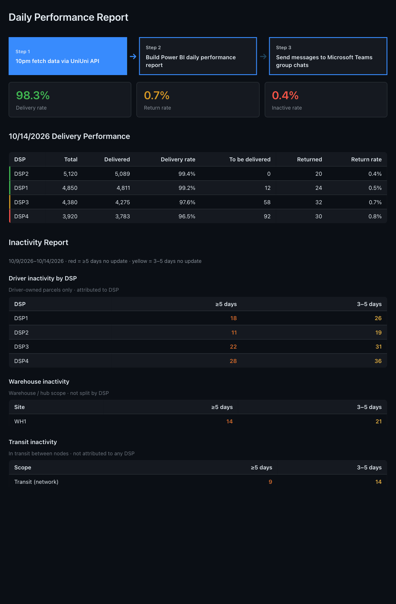

# Daily Performance Report

### Demo (anonymized and simplified sample)

  

**Interactive demo (GitHub Pages):** `https://yxwvwxy.github.io/delivery-pivot/` — same dashboard as the Canvas, with live pipeline steps (timing matches exactly).

---

## About this project

**delivery-pivot** supports last-mile **DSP (delivery service provider) performance reporting**: nightly parcel data is pulled, rolled into a daily performance view, and shared with DSP teams. The demo above shows the target report shape—delivery and return rates, per-DSP delivery tables, and inactivity broken out by driver (by DSP), warehouse, and transit.

This repository holds:

| Piece | Role |
|--------|------|
| `canvases/ewr-performance-dashboard.canvas.tsx` | Cursor Canvas mock of the daily report (sample data) |
| `docs/daily-performance-report.html` | Static preview deployed to GitHub Pages |
| `Code.gs` | Google Apps Script for the operational spreadsheet workflow |

### Nightly flow (target)

1. Fetch parcel events via **UniUni API**
2. Build the **Power BI** daily performance report
3. Post summaries to **Microsoft Teams** group chats

### Spreadsheet workflow (`Code.gs`)

Used alongside `delivery_monitoring` and `dsp_mapping` sheets:

1. Refresh monitoring data.
2. **Generate today’s delivery tab** — freeze past date tabs as values, then create or refresh the tab for the report date. Seed driver→DSP mappings are appended only; manual mapping rows are never cleared. Incorrect “unknown” rows on frozen tabs can be cleaned when mappings were fixed in columns Q/R.
3. **Update DSP Mapping** — for unknown drivers, set Team ID in column R; writes mapping and freezes summary columns A–L for that day.
4. **Generate group messages** — optional Teams copy in columns T–Z for seven master DSPs.

**Master DSPs:** Final Mile, Gawen Group, LITTLESNAILS, LYL EXPRESS INC, shunda express service, WUKONG, Yuanyuan Pan.

**Menu (DSP Tools):** generate today’s delivery tab → repair column Q formulas → Update DSP Mapping → generate group messages.

**Install:** In the spreadsheet, open Extensions → Apps Script, replace the project script with `Code.gs`, save, refresh, then run generate today’s delivery tab once.

### Metrics (report logic)

- **Total parcels:** statuses 200, 202, 211, 213, 231, 232, 203  
- **Delivery rate:** (total − 202) / total  
- **Return rate:** (211 + 231 + 232) / total  
- **Inactivity:** ≥5 days without update (critical), 3–5 days (watch); driver parcels attributed to DSP; warehouse and transit scoped separately from DSP
