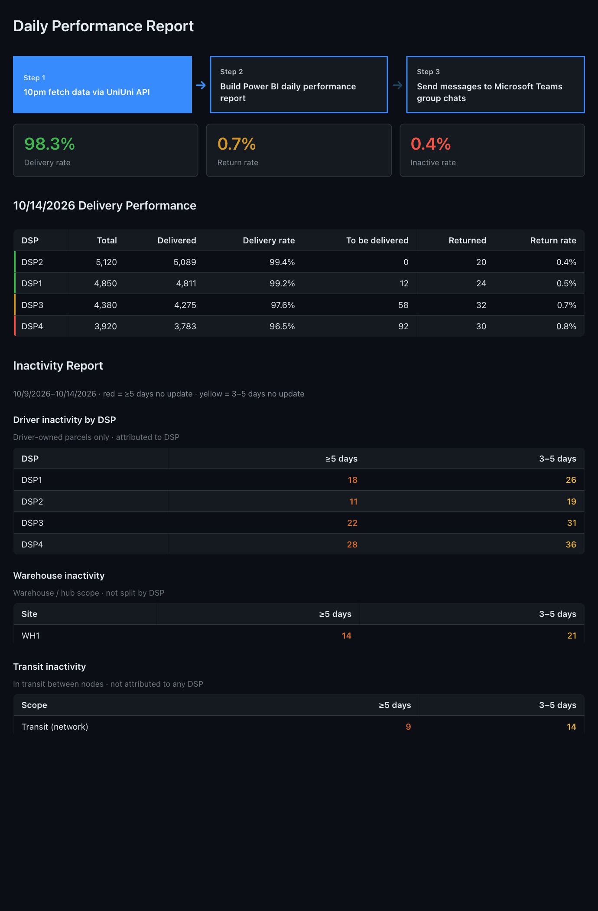

# Daily Performance Report

### Demo (anonymized and simplified sample)

  

**Interactive demo (GitHub Pages):** after you enable Pages (Settings → Pages → Build and deployment → **GitHub Actions**), open `https://yxwvwxy.github.io/delivery-pivot/` — same dashboard as the Canvas, with live 2.2s pipeline steps (not a GIF; timing matches exactly).
